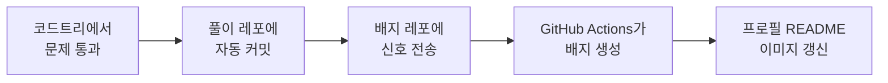

<div align="center">

# 🌳 CodeTree Badge Generator

**코드트리 학습 현황을 GitHub 프로필에 실시간으로 보여주는 배지**

<br>

<picture>
  <source media="(prefers-color-scheme: dark)" srcset="https://raw.githubusercontent.com/kannikii/CodeTree_badge_generator/output/codetree-dark.svg">
  
</picture>

<sub>제작자의 실제 배지입니다. 문제를 풀 때마다 자동으로 바뀝니다.</sub>

<br><br>

📝 **스크린샷으로 따라 하는 설치 가이드와 만든 과정** → [velog에서 보기](https://velog.io/@kannikii/%EA%B9%83%ED%97%88%EB%B8%8C-%EC%BD%94%EB%93%9C%ED%8A%B8%EB%A6%AC-%ED%95%99%EC%8A%B5-%ED%8A%B8%EB%9E%98%ED%82%B9-%EB%B0%B0%EC%A7%80-%EC%B6%94%EA%B0%80%ED%95%98%EA%B8%B0)

</div>

<br>

## ✨ 특징

- **자동 갱신** — 코드트리에서 문제를 통과하면 몇 분 안에 배지가 바뀝니다.
- **계정 정보 불필요** — 코드트리 아이디·비밀번호를 입력하지 않습니다.
- **다크 모드 대응** — 보는 사람의 GitHub 테마에 맞춰 색이 바뀝니다.
- **서버 불필요** — GitHub Actions만으로 무료로 동작합니다.

<br>

## 📊 배지 읽는 법

| 영역 | 보여주는 내용 |
|:--|:--|
| 상단 | 전체 트레일 완료율 |
| 트레일 카드 | 가장 많이 푼 트레일의 레슨 현황 (육각형 1개 = 레슨 1개) |
| 스트릭 카드 | 현재 연속 · 최장 연속 · 총 학습일, 최근 4주 기록 |
| 하단 | 가장 최근에 통과한 문제 |

| 모양 | 의미 |
|:--:|:--|
|  | **완료됨** — 레슨의 모든 문제를 통과했습니다 |
|  | **테스트 완료** — 테스트 문제는 통과했고, 나머지가 남았습니다 |
|  | **시작됨** — 한 문제 이상 통과했습니다 |
|  | **시작하지 않음** |
|  | **학습 중** — 가장 최근에 문제를 푼 레슨입니다 |

<br>

## ✅ 시작하기 전에

코드트리의 **GitHub 연동**이 켜져 있어야 합니다.
코드트리 오른쪽 위 **`My`** → **`Github에 학습 기록 남기기`** 에서 GitHub 계정과 레포를 연결합니다.

> ⚠️ 연동 설정의 **맞춘 제출만 커밋하기**는 체크한 채로 두세요. 체크를 풀면 틀린 제출까지 올라가서 배지 집계가 부정확해질 수 있습니다.

연동이 켜져 있으면 문제를 통과할 때마다 내 레포에 아래와 같은 커밋이 자동으로 쌓입니다.
이 가이드에서는 이 레포를 **풀이 레포**라고 부릅니다.

```
[Passed] 되돌아오기 (2ms, 0MB)
```

<br>

## 🚀 설치 가이드

> 5분 정도면 끝납니다. 순서대로 따라 하세요.

<br>

### 1단계 · Fork 하기

이 레포 오른쪽 위의 **`Fork`** → **`Create fork`** 를 누릅니다.

<br>

### 2단계 · Actions 켜기

Fork한 레포의 **`Actions`** 탭에서 **`I understand my workflows, go ahead and enable them`** 을 누릅니다.

<br>

### 3단계 · 풀이 레포 연결하기

**`Settings`** → **`Secrets and variables`** → **`Actions`** → **`Variables`** 탭 → **`New repository variable`**

| Name | Value |
|:--|:--|
| `CODETREE_REPO` | `내아이디/풀이레포` &nbsp;(예: `kannikii/PS`) |

<br>

### 4단계 · 첫 배지 만들기

**`Actions`** → **`Update CodeTree badge`** → **`Run workflow`** 를 누릅니다.

> ✅ 1분쯤 뒤 브랜치 목록에 **`output`** 이 생기면 성공입니다.

<br>

### 5단계 · 실시간 갱신 연결하기

문제를 풀자마자 배지가 바뀌도록, 풀이 레포가 배지 레포에 신호를 보내게 만듭니다.
이 단계를 건너뛰면 배지는 하루 한 번(00:07)만 갱신됩니다.

**① 토큰 만들기**

GitHub 프로필 사진 → **`Settings`** → **`Developer settings`** → **`Fine-grained tokens`** → **`Generate new token`**

| 항목 | 입력값 |
|:--|:--|
| Token name | 아무 이름 (예: `codetree-badge`) |
| Repository access | **`Only select repositories`** → 내 `CodeTree_badge_generator` |
| Permissions | **`Contents`** → **`Read and write`** |

> ⚠️ 만들어진 토큰(`github_pat_...`)은 한 번만 보입니다. 바로 복사해 두세요.

**② 풀이 레포에 토큰 등록하기**

풀이 레포 → **`Settings`** → **`Secrets and variables`** → **`Actions`** → **`New repository secret`**

| Name | Secret |
|:--|:--|
| `CODETREE_BADGE_TOKEN` | ①에서 복사한 토큰 |

**③ 풀이 레포에 워크플로 추가하기**

풀이 레포에 `.github/workflows/codetree-badge-dispatch.yml` 파일을 만들고 아래 내용을 붙여 넣습니다. **`내아이디`** 만 바꾸면 됩니다.

```yaml
name: codetree-badge-dispatch

on:
  push:
    branches: [main]

jobs:
  codetree-badge:
    runs-on: ubuntu-latest
    steps:
      - uses: peter-evans/repository-dispatch@v4
        with:
          token: ${{ secrets.CODETREE_BADGE_TOKEN }}
          repository: 내아이디/CodeTree_badge_generator
          event-type: codetree-passed
          client-payload: '{"codetree_repo": "${{ github.repository }}"}'
```

> 💡 풀이 레포에 이미 다른 워크플로(백준·프로그래머스 배지 등)가 있다면, 그 파일 아래에 이어 붙이지 말고 **새 파일로** 만드세요.

> ✅ 문제를 하나 푼 뒤 배지 레포의 `Actions` 탭에 새 실행이 생기면 연결 완료입니다.

<br>

### 6단계 · 프로필에 배지 붙이기

프로필 레포(`내아이디/내아이디`)의 `README.md`에 붙여 넣습니다. **`내아이디`** 두 곳만 바꾸면 됩니다.

```html
<picture>
  <source media="(prefers-color-scheme: dark)" srcset="https://raw.githubusercontent.com/내아이디/CodeTree_badge_generator/output/codetree-dark.svg">
  
</picture>
```

> 💡 배지를 조금 작게 하려면 `` 처럼 `width`를 넣으세요.

<br>

**🎉 끝! 이제 문제를 풀 때마다 프로필 배지가 자동으로 바뀝니다.**

<br>

## ⚙️ 옵션

필요할 때만 `Settings` → `Secrets and variables` → `Actions` 에서 추가합니다.

| 이름 | 종류 | 설명 | 기본값 |
|:--|:--:|:--|:--:|
| `BADGE_TRAIL` | Variable | 보여줄 트레일 고정 (`1`~`6`) | 가장 많이 푼 트레일 |
| `BADGE_TIMEZONE` | Variable | 하루를 나누는 기준 시간대 | `Asia/Seoul` |
| `CODETREE_REPO_TOKEN` | Secret | 풀이 레포가 **private**일 때 읽기용 토큰 | - |

<br>

## ❓ 자주 묻는 질문

<details>
<summary><b>배지 이미지가 깨져 보여요</b></summary>

주소의 아이디와 브랜치 이름(`output`)을 확인하세요. 4단계를 실행하지 않았다면 `output` 브랜치가 아직 없습니다. 배지 레포는 **public**이어야 합니다.

</details>

<details>
<summary><b>문제를 풀었는데 배지가 그대로예요</b></summary>

이미지는 최대 5분 동안 캐시됩니다. 잠시 후 강력 새로고침(<kbd>Cmd</kbd>+<kbd>Shift</kbd>+<kbd>R</kbd>)을 해 보세요.
그래도 그대로라면 풀이 레포 → 배지 레포 순서로 `Actions` 실행 기록을 확인하세요.

</details>

<details>
<summary><b>풀이 레포의 Actions가 실패해요</b></summary>

토큰이 없거나 만료된 경우입니다. 5단계 ①, ②를 다시 진행하세요.

</details>

<details>
<summary><b>예전에 푼 문제가 집계되지 않아요</b></summary>

GitHub 연동을 켜기 전에 푼 문제는 풀이 레포에 기록이 없어서 셀 수 없습니다.

</details>

<details>
<summary><b>코드트리 화면과 조금 달라요</b></summary>

배지는 풀이 레포의 **통과 기록**만 봅니다.
- 시도만 하고 통과하지 못한 레슨은 "시작하지 않음"으로 보입니다.
- 연속 일수는 "통과한 문제가 있는 날"을 기준으로 셉니다.

</details>

<details>
<summary><b>원본 레포가 업데이트되면 어떻게 받나요?</b></summary>

Fork한 레포에서 `Sync fork` → `Update branch`를 누르면 됩니다. 배지 파일은 별도 브랜치(`output`)에 있어서 충돌이 나지 않습니다.

</details>

<details>
<summary><b>하루 한 번 갱신이 멈췄어요</b></summary>

GitHub는 60일 동안 활동이 없는 레포의 예약 실행을 끕니다. `Actions` 탭에서 다시 켜 주세요.

</details>

<br>

## 🔧 동작 원리



<details>
<summary>자세히 보기</summary>

- **통과 기록**: 풀이 레포의 커밋 이력에서 읽습니다. 커밋마다 남는 `README.md`의 카드 링크로 어떤 문제인지 구분합니다.
- **커리큘럼 구조**: 코드트리가 로그인 없이 공개하는 커리큘럼 정보에서 트레일·레슨 구성을 가져옵니다.
- **갱신 시점**: 풀이 레포에 커밋이 생길 때, 매일 00:07(KST), `Run workflow`를 눌렀을 때.
- **결과물**: `output` 브랜치에 `codetree-light.svg`, `codetree-dark.svg`로 저장됩니다.

</details>

<details>
<summary>로컬에서 실행하기 (개발자용)</summary>

Python 3.12 이상만 있으면 됩니다. 외부 패키지는 쓰지 않습니다.

```bash
# 샘플 데이터로 미리보기
python3 -m codetree_badge --sample --out preview

# 내 풀이 레포로 만들기
git clone https://github.com/내아이디/풀이레포.git ps
python3 -m codetree_badge --solutions ps --out dist

# 테스트
python3 -m unittest discover -s tests -t .
```

</details>

<br>

## 📄 라이선스

[MIT](LICENSE) · 코드트리(Codetree)와 관련 없는 비공식 프로젝트입니다. 코드트리 계정 정보는 사용하지 않으며, 공개된 커리큘럼 정보와 본인의 풀이 레포만 읽습니다.
